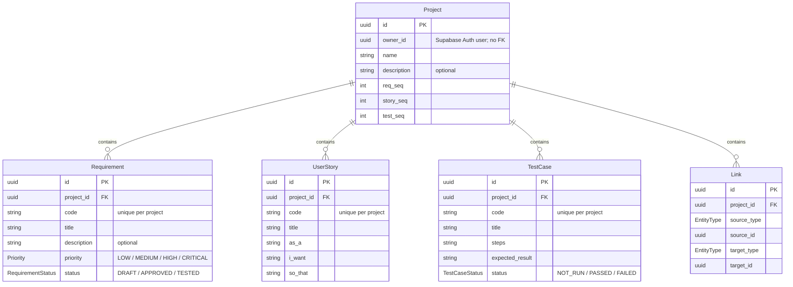
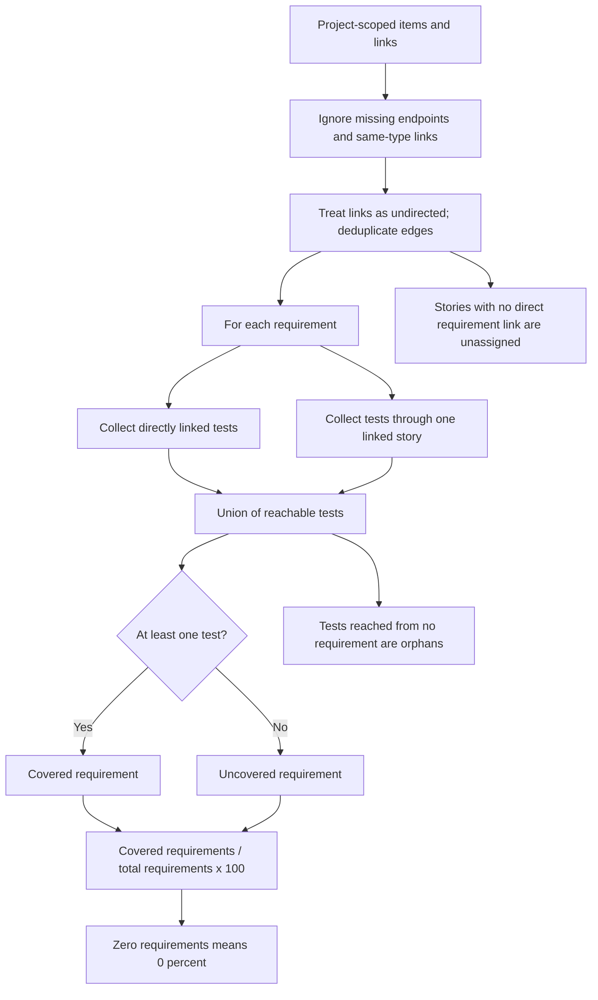

# Traceboard

A requirements traceability workspace that connects business requirements, user stories, and test cases to make coverage gaps visible.

**Live demo:** [TODO: Add deployed application URL]

**Screenshots / GIF:** [TODO: Add an overview screenshot, a matrix screenshot, and a short create-and-link walkthrough GIF]

## Why I Built This

Requirements traceability is a core business analysis deliverable: teams need to show how a business need connects to delivery work and how it will be verified. A requirement list alone does not reveal missing tests or work that has no clear requirement behind it.

I built Traceboard to turn that deliverable into a working application. It combines the analysis workflow with full-stack engineering: relational modelling, authenticated ownership checks, atomic reference-code generation, testable coverage rules, and an interactive traceability matrix.

## Features

- Email/password authentication with email-confirmation handling and session refresh.
- Private project dashboard with item counts, project creation, and confirmed deletion.
- Requirements, stories, and test cases with validated create/edit/delete dialogs and readable project-specific codes.
- Shareable title/code search and requirement priority/status and test-status filters.
- Searchable link picker with endpoint ownership checks and duplicate/self-link protection.
- Interactive requirements-by-tests matrix with sticky headers, contained scrolling, and uncovered-row highlighting.
- Coverage overview with linked lists of uncovered requirements, orphan tests, and stories without requirements.
- Authenticated CSV exports with proper escaping and spreadsheet formula-injection protection.
- Idempotent banking demo seed with deliberate gaps for exploring the workflow.

## Tech Stack

| Layer | Technology | Purpose |
| --- | --- | --- |
| Application | Next.js 16 App Router, React 19, TypeScript | Server-rendered pages, server actions, and API routes |
| UI | Tailwind CSS 4, shadcn/ui, Base UI, Lucide, Sonner | Accessible controls, styling, icons, and feedback |
| Authentication | Supabase Auth, `@supabase/ssr` | Verified users and cookie-based sessions |
| Database | Supabase PostgreSQL, Prisma 7, PostgreSQL adapter | Typed queries, migrations, and transactions |
| Validation | Zod | Shared input schemas and inferred types |
| Testing | Vitest, Playwright | Unit tests and a real-browser happy path |
| Automation | GitHub Actions | Push/PR checks and a separate manual E2E workflow |

## Data Model

All application IDs are UUIDs; every table has `created_at` and `updated_at` timestamps. Project deletion cascades to its child rows.



`Link` uses polymorphic endpoints rather than database foreign keys to individual items. Server actions verify that both endpoints exist in the owned project. Allowed pairs are requirement/story, requirement/test, and story/test. The database enforces a unique directed endpoint tuple; application logic also rejects reversed duplicates. Counters are incremented transactionally to generate codes such as `REQ-001`, `US-001`, and `TC-001` without concurrent-create collisions.

## Coverage Rules

All coverage calculations live in the pure, typed [`src/lib/coverage.ts`](src/lib/coverage.ts) module, shared by the overview, matrix, and CSV export.



Only direct requirement-to-test links and two-hop requirement-to-story-to-test paths count. Longer paths do not. Test execution status does not affect coverage: **covered means a test is linked, not that it passed**. Story-only matrix checks are read-only; direct checks can be toggled.

## Local Setup

Prerequisites: a supported Node.js LTS release, npm, and a Supabase project with email/password authentication enabled. Run commands from the repository root.

### 1. Install and Configure

```sh
npm ci
cp .env.example .env.local
```

On PowerShell, use `Copy-Item .env.example .env.local` instead of `cp` if needed. Fill in:

| Variable | Value |
| --- | --- |
| `NEXT_PUBLIC_SUPABASE_URL` | Supabase project URL |
| `NEXT_PUBLIC_SUPABASE_ANON_KEY` | Supabase anon client key; alternatively use `NEXT_PUBLIC_SUPABASE_PUBLISHABLE_KEY` with a publishable key |
| `DATABASE_URL` | Pooled PostgreSQL connection string, port `6543` |
| `DIRECT_URL` | Migration connection string, port `5432`; use the session pooler on `5432` if direct networking is unavailable |
| `SEED_USER_ID` | Existing Supabase Auth user's UUID for demo ownership |
| `E2E_TEST_EMAIL`, `E2E_TEST_PASSWORD` | Optional dedicated, confirmed test account for Playwright |

Find API values in Supabase project settings and connection strings in the project's **Connect** dialog. Never commit `.env.local` or put database passwords/service-role keys in `NEXT_PUBLIC_*` variables.

### 2. Apply Migrations and RLS

```sh
npx prisma generate
npx prisma migrate dev
```

Then open **Supabase > SQL Editor > New query**, paste [`prisma/sql/rls.sql`](prisma/sql/rls.sql), and run it as `postgres`. The policy script is idempotent and must run after the tables exist.

Prisma's `postgres` connection bypasses RLS. Server-side ownership checks remain mandatory; RLS protects authenticated Supabase Data API access as defense-in-depth. See [RLS notes](docs/rls.md).

### 3. Seed the Demo

Create and confirm an Auth account, then copy its UUID from **Supabase > Authentication > Users** into `SEED_USER_ID`.

```sh
npx prisma db seed
```

This creates **Online Banking App** with 8 requirements, 6 stories, 10 tests, and 62.5% coverage. Reruns preserve the existing demo unchanged. See [seed details](docs/seed.md).

### 4. Start the App

```sh
npm run dev
```

Open [localhost:3000](http://localhost:3000), log in as the seeded owner, and explore the project's **Overview** and **Matrix** tabs. With email confirmation enabled, confirm your address before logging in. Configure Supabase's local Site URL and email-confirmation redirect/template settings for the environment you use.

## Scripts

| Command | Purpose |
| --- | --- |
| `npm run dev` | Start the development server |
| `npm run build` | Create the production build |
| `npm start` | Serve a production build |
| `npm run lint` | Run ESLint |
| `npm run typecheck` | Run TypeScript without emitting files |
| `npm test` | Run Vitest; live-database suites are opt-in |
| `npm run e2e` | Run the Playwright happy path |
| `npm run test:rls` | Test Data API isolation with two real Auth users |
| `npm run postinstall` | Generate Prisma Client automatically after dependency installation |
| `npx prisma db seed` | Create the demo for `SEED_USER_ID` |
| `npx prisma migrate status` | Check migration status |

## Testing

```sh
npm run lint
npm run typecheck
npm test
npm run build
```

Unit coverage includes validation, direct/indirect traceability rules, duplicate and reversed links, ownership-sensitive loading/export paths, CSV escaping/formula protection, and seed fixtures/idempotency behavior. Live-database integration suites are separate from the default unit run.

For browser testing, set `E2E_TEST_EMAIL` and `E2E_TEST_PASSWORD` to a dedicated confirmed user in an isolated test project:

```sh
npx playwright install chromium
npm run e2e
```

The happy path logs in, creates a project, requirement, and test case, links the items, checks the matrix and 100% coverage, then deletes its temporary project. Optional signup mode and alternate server/browser settings are documented in [E2E setup](docs/e2e.md).

For RLS testing, configure `RLS_TEST_USER_A_EMAIL`, `RLS_TEST_USER_A_PASSWORD`, `RLS_TEST_USER_B_EMAIL`, and `RLS_TEST_USER_B_PASSWORD` for two distinct confirmed Auth users, then run `npm run test:rls`. Use a test database, not production.

Push/PR CI runs lint, typecheck, unit tests, and a build with dummy environment values. Browser tests run only through the separate **E2E** workflow's **Run workflow** action and require real test-environment secrets. Dummy build values do not verify connectivity or database security.

## Deployment

Deploy as a Next.js server application, not a static export. A Node-capable hosting service can build with `npm ci` and `npm run build`, then serve with `npm start`.

1. Provision a production Supabase project and set its URL, client key, `DATABASE_URL`, and `DIRECT_URL` as hosting secrets/environment variables. Public Supabase values must be available at build time too.
2. Run `npx prisma migrate deploy` in a controlled release step with access to the production migration connection. Do not run `migrate dev` in production.
3. Apply `prisma/sql/rls.sql` to production and review policies and database privileges.
4. Configure the production Site URL, allowed redirects, and confirmation email settings in Supabase Auth for the deployed domain.
5. Verify login, project isolation, link creation, coverage, and CSV downloads after release. Use separate test credentials/database for the manual E2E workflow.

Do not seed production automatically or upload local environment files, test credentials, or authentication artifacts. The demo seed is an explicit development tool.

## Roadmap

- Requirement change history and an audit trail.
- Team workspaces with role-based access.
- CSV import and bulk editing.
- Release baselines and coverage comparisons over time.
- Richer test execution history and reporting.

These are planned directions, not current features.

## License

Released under the [MIT License](LICENSE).
